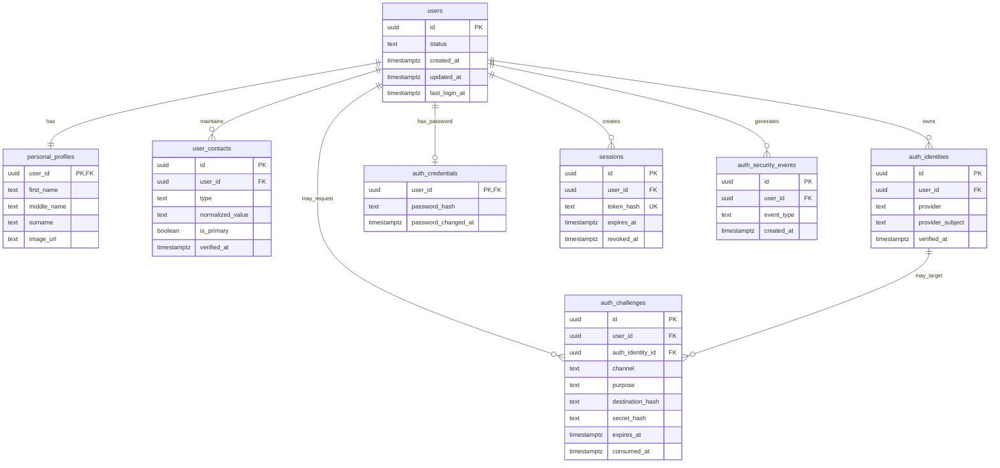

> **Project Hub status: Planned design reference.** This document describes a
> proposed Phase 1 schema and implementation approach. It is not evidence that
> every table, field, constraint, or flow below exists in the current
> repository. Check the actual migrations before relying on an implementation
> claim.

# Vyasen — Phase 1 Database Design

- **Status:** Approved requirements / proposed implementation baseline
- **Version:** 1.0 · 2026-11-13
- **Platform:** PostgreSQL 18, Kysely, TypeScript
- **Scope:** Global accounts, personal profiles and contacts, authentication, OTP, sessions and security.

> This document is the Phase 1 implementation design, not a claim that the SQL has been executed or independently security-audited. It supersedes the disposable development schema. Institutional memberships, roles, family verification, portfolio records and institutional contact approval are explicitly deferred.

## 1. Requirements and boundaries

- One permanent global `users.id` across all future institutions and capacities.
- Supported now: email/password (verify email via OTP before initial password setup), email OTP-only, phone/SMS OTP-only (feature-gated when SMS provider unavailable), Google OAuth, Google One Tap.
- Future: GitHub, Apple and other verified provider identities.
- Account created after successful OTP-only signup; a `personal_profiles` row is created in the same transaction even if name fields are blank. OAuth signup also creates both rows and may prefill provider name/image as **unverified profile suggestions**.
- First name, optional middle name and surname only; no distinct legal, professional or display-name columns. Profile can be edited; changes do not rewrite institutional records.
- Multiple verified personal emails/phones, one primary per type; contact records do not grant login rights. Contacts may eventually be shared only by verified eligible family members; **do not enable shared-contact registration until relationship verification exists**.
- Authentication identifiers are uniquely owned by a single account. Never infer account ownership or auto-link from matching provider email, personal contact, surname or family relationship.
- Account linking requires existing-account authentication or a separately approved secure linking flow; never lock users out by unlinking their last usable method.
- Institutional contacts are separate, never automatically synchronized. No institution-specific columns in Phase 1 tables.
- The frontend is not a security boundary. All feature gates, OTP checks, authorization and session checks are enforced server-side.

## 2. Data ownership and relationship diagram

`auth_nonces` and `auth_rate_limits` are standalone short-lived security tables; they are intentionally omitted from the diagram to keep it readable. Nullable user IDs in challenges/events support pre-account signup and failed authentication events.

## 3. Exact proposed tables and columns

**Conventions:** UUID primary keys; `timestamptz`; lowercase snake_case; database UTC semantics; `created_at` defaults to `now()`; application updates `updated_at` in each write (or use a trigger consistently); no hard-delete of a user with issued institutional records. `text` plus CHECK constraints is preferred to PostgreSQL enums for frequently evolving provider/purpose values. Avoid storing raw OTPs, session tokens or secrets.

### 3.1 `users` — global account anchor

| Column          | PostgreSQL type | Rule                                                       |
| --------------- | --------------- | ---------------------------------------------------------- |
| `id`            | uuid            | PK, default `gen_random_uuid()`                            |
| `status`        | varchar(20)     | NOT NULL, default `active`; CHECK in (`active`,`disabled`) |
| `created_at`    | timestamptz     | NOT NULL, default now()                                    |
| `updated_at`    | timestamptz     | NOT NULL, default now()                                    |
| `last_login_at` | timestamptz     | nullable                                                   |

No mandatory `email`, `phone`, `name`, `password_hash`, `tenant_id`, or `school_id` on `users`. Disabling an account blocks all authentication methods and sessions. `last_login_at` is operational metadata, not proof of identity.

### 3.2 `personal_profiles` — canonical user-entered profile

| Column                     | Type         | Rule                                                                      |
| -------------------------- | ------------ | ------------------------------------------------------------------------- |
| `user_id`                  | uuid         | PK, FK `users.id` ON DELETE CASCADE                                       |
| `first_name`               | varchar(100) | nullable until completed                                                  |
| `middle_name`              | varchar(100) | nullable                                                                  |
| `surname`                  | varchar(100) | nullable until completed                                                  |
| `image_url`                | text         | nullable; validated URL or media object reference at application boundary |
| `created_at`, `updated_at` | timestamptz  | NOT NULL, default now()                                                   |

Create one profile row in the same transaction as every user. Do not require a name for OTP-only signup. Google names may prefill these fields but are not legal-name verification. Add trimmed/nonblank checks **when non-null**; preserve user-provided Unicode, and do not force western name patterns. Profile edits require authentication and ownership; profile verification/official institutional identity is deferred.

### 3.3 `user_contacts` — personal communication endpoints, not login rights

| Column                     | Type        | Rule                                                      |
| -------------------------- | ----------- | --------------------------------------------------------- |
| `id`                       | uuid        | PK, default gen_random_uuid()                             |
| `user_id`                  | uuid        | NOT NULL FK `users.id` ON DELETE CASCADE                  |
| `type`                     | varchar(10) | NOT NULL, CHECK (`email`,`phone`)                         |
| `normalized_value`         | text        | NOT NULL; email canonicalized conservatively, phone E.164 |
| `verified_at`              | timestamptz | NOT NULL for persisted active contacts in Phase 1         |
| `is_primary`               | boolean     | NOT NULL default false                                    |
| `created_at`, `updated_at` | timestamptz | NOT NULL default now()                                    |

Indexes: UNIQUE (`user_id`,`type`,`normalized_value`); partial UNIQUE (`user_id`,`type`) WHERE `is_primary`; index (`type`,`normalized_value`) for duplicate detection (not unique globally). Require normalized value and length checks at API and database where feasible. New contacts must be verified **before** insertion (unverified proposed destinations live in `auth_challenges`). One primary **at most** per type is DB-enforced; for users with any contacts of that type, the service transaction must establish exactly one primary. Change-primary operations serialize using a `users` row lock to avoid races. Do not use a personal contact lookup alone to resolve authentication. Shared contacts require family verification **before the feature is enabled**; current Phase 1 API can reject cross-user duplicates until then, without a global UNIQUE index that would obstruct future sharing.

### 3.4 `auth_identities` — unique account login ownership

| Column             | Type        | Rule                                                                |
| ------------------ | ----------- | ------------------------------------------------------------------- |
| `id`               | uuid        | PK                                                                  |
| `user_id`          | uuid        | NOT NULL FK `users.id` ON DELETE CASCADE                            |
| `provider`         | varchar(32) | NOT NULL; Phase 1 `email`,`phone`,`google`; future `github`,`apple` |
| `provider_subject` | text        | NOT NULL; canonical email, E.164 phone, or stable provider `sub`    |
| `verified_at`      | timestamptz | NOT NULL                                                            |
| `created_at`       | timestamptz | NOT NULL default now()                                              |
| `last_used_at`     | timestamptz | nullable                                                            |

UNIQUE (`provider`,`provider_subject`) ensures an authentication identity can never belong to two accounts. UNIQUE (`user_id`,`provider`,`provider_subject`) is redundant and omitted. **Do not add UNIQUE (`user_id`,`provider`)**: multiple verified email/phone identities or multiple accounts at a future provider may be linked if security rules permit. Index (`user_id`,`provider`). Google OAuth and One Tap share `provider='google'` and the same provider subject. The provider's email claim is not the provider subject and never triggers automatic account merging. `auth_identities` is the authoritative lookup for email/phone OTP and email/password login, not `user_contacts`.

### 3.5 `auth_credentials` — optional password

| Column                | Type        | Rule                                                      |
| --------------------- | ----------- | --------------------------------------------------------- |
| `user_id`             | uuid        | PK and FK `users.id` ON DELETE CASCADE                    |
| `password_hash`       | text        | NOT NULL; Argon2id encoded hash including parameters/salt |
| `created_at`          | timestamptz | NOT NULL default now()                                    |
| `password_changed_at` | timestamptz | NOT NULL default now()                                    |

A password is an **account-level credential**, not a second provider identity. Password sign-in uses a uniquely linked, verified **email** auth identity to find the user, then checks this row. Email OTP-only and phone OTP-only accounts may have no password row. Password setup requires verified email identity and recent appropriate authorization; do not treat possession of a family-shared personal contact as sufficient. Never store passwords or reversible encrypted passwords. Rate-limit password checks and consider revoking other sessions on password reset.

### 3.6 `auth_challenges` — single-use OTP and action verification

| Column             | Type        | Rule                                                                                           |
| ------------------ | ----------- | ---------------------------------------------------------------------------------------------- |
| `id`               | uuid        | PK                                                                                             |
| `user_id`          | uuid        | nullable FK `users.id` ON DELETE CASCADE; null for pre-signup                                  |
| `auth_identity_id` | uuid        | nullable FK `auth_identities.id` ON DELETE CASCADE                                             |
| `channel`          | varchar(10) | NOT NULL CHECK (`email`,`sms`)                                                                 |
| `purpose`          | varchar(32) | NOT NULL; `signup`,`sign_in`,`password_setup`,`password_reset`,`account_link`,`contact_verify` |
| `destination_hash` | char(64)    | NOT NULL; keyed digest of normalized destination, not raw email/phone                          |
| `secret_hash`      | text        | NOT NULL; keyed digest of OTP bound to challenge ID/purpose; no raw OTP                        |
| `attempt_count`    | smallint    | NOT NULL default 0; CHECK between 0 and configured max (e.g. 5)                                |
| `expires_at`       | timestamptz | NOT NULL                                                                                       |
| `consumed_at`      | timestamptz | nullable                                                                                       |
| `created_at`       | timestamptz | NOT NULL default now()                                                                         |

Indexes: (`destination_hash`,`purpose`,`created_at` DESC); (`user_id`,`created_at` DESC) WHERE `user_id IS NOT NULL`; (`expires_at`) for cleanup. For account-specific login, bind challenge to the **resolved auth identity/user**. For signup, `user_id` is null and the destination must not already be an auth identity owned by another account. Challenge issue and verify must check the server-side SMS feature gate. Use cryptographically secure OTP generation, a server-secret keyed hash/HMAC for low-entropy OTPs, constant-time comparison, strict expiration, attempt caps, resend cooldown, IP/identity throttling and atomic consume (`UPDATE ... WHERE consumed_at IS NULL AND expires_at > now() ... RETURNING`). Store a destination snapshot or encrypted delivery address only if required for sending and minimize its retention; `destination_hash` alone is not deliverable. Never let a `contact_verify` OTP authorize `sign_in` or `account_link`.

**Operational note:** OTP verification and signup must be race-safe: atomically consume challenge and insert `users`, `personal_profiles`, `auth_identities`, `user_contacts` and optional `auth_credentials` within a transaction; the UNIQUE provider/subject constraint is the final defense against concurrent duplicate signups. For outbound SMS/email delivery, issue challenge then send via a delivery job/outbox or handle send failure explicitly; do not hold DB transactions open during network calls.

### 3.7 `sessions` — revocable server-side sessions

| Column           | Type          | Rule                                                   |
| ---------------- | ------------- | ------------------------------------------------------ |
| `id`             | uuid          | PK                                                     |
| `user_id`        | uuid          | NOT NULL FK `users.id` ON DELETE CASCADE               |
| `token_hash`     | char(64)      | NOT NULL UNIQUE; hash high-entropy random bearer token |
| `ip_address`     | inet          | nullable                                               |
| `user_agent`     | varchar(1024) | nullable                                               |
| `device_name`    | varchar(200)  | nullable                                               |
| `created_at`     | timestamptz   | NOT NULL default now()                                 |
| `last_active_at` | timestamptz   | NOT NULL default now()                                 |
| `expires_at`     | timestamptz   | NOT NULL                                               |
| `revoked_at`     | timestamptz   | nullable                                               |

Indexes: (`user_id`,`created_at` DESC) WHERE `revoked_at IS NULL`; (`expires_at`) for cleanup. A session is valid only when user active, not revoked and not expired. Server must enforce maximum concurrent sessions transactionally if enabled, not through UI. Use secure HttpOnly cookies, `Secure`, appropriate `SameSite`, CSRF defenses where applicable, token rotation where appropriate and generic error responses. Device/browser/OS can be derived for display without storing redundant columns initially.

### 3.8 `auth_nonces` — OAuth/One Tap protocol replay protection

| Column        | Type        | Rule                            |
| ------------- | ----------- | ------------------------------- |
| `nonce_hash`  | char(64)    | PK                              |
| `purpose`     | varchar(32) | NOT NULL; e.g. `google_one_tap` |
| `expires_at`  | timestamptz | NOT NULL                        |
| `consumed_at` | timestamptz | nullable                        |
| `created_at`  | timestamptz | NOT NULL default now()          |

Index (`expires_at`). Nonces are cryptographically random, short-lived and consumed atomically. OAuth redirect `state` and PKCE values also require correct flow-bound validation; do not assume a nonce table alone implements OAuth security. Keep only protocol values needed by the chosen flow.

### 3.9 `auth_rate_limits` — durable coarse abuse control

| Column              | Type        | Rule                                                  |
| ------------------- | ----------- | ----------------------------------------------------- |
| `bucket_hash`       | char(64)    | PK; keyed digest of action + principal/IP/destination |
| `window_started_at` | timestamptz | NOT NULL                                              |
| `request_count`     | integer     | NOT NULL CHECK > 0                                    |
| `expires_at`        | timestamptz | NOT NULL                                              |

Index (`expires_at`). Atomic UPSERT/increment with clear window semantics. For high-throughput production, Redis may handle hot-path rate limits while PostgreSQL retains critical safeguards; never assume frontend throttling suffices.

### 3.10 `auth_security_events` — minimal security audit (recommended)

| Column        | Type        | Rule                                                                                               |
| ------------- | ----------- | -------------------------------------------------------------------------------------------------- |
| `id`          | uuid        | PK                                                                                                 |
| `user_id`     | uuid        | nullable FK `users.id` ON DELETE SET NULL                                                          |
| `event_type`  | varchar(48) | NOT NULL                                                                                           |
| `identity_id` | uuid        | nullable; intentionally not a hard FK if historical identity deletion must not erase audit context |
| `occurred_at` | timestamptz | NOT NULL default now()                                                                             |
| `metadata`    | jsonb       | NOT NULL default `{}`; strictly allowlisted, no secrets/OTP/tokens                                 |

Indexes (`user_id`,`occurred_at` DESC); (`event_type`,`occurred_at` DESC). Log account creation, identity link/unlink, password changes, account disable, session revoke and relevant failed security operations. Establish retention and redaction policies before production. This is the **tenth** recommended table: nine functional tables plus one minimal security audit table.

## 4. Authentication flows and transaction boundaries

### Email + password signup

1. User enters email; server normalizes and issues `signup` email OTP without exposing account existence.
2. User verifies OTP; server records a short-lived, single-use proof tied to this signup flow (or holds consumed challenge in an authorized transaction-safe continuation).
3. User supplies password and optionally name; backend verifies proof, hashes password with Argon2id.
4. Transaction creates user, profile, email auth identity, verified contact, password credential and session. Consume proof atomically; reject identity uniqueness conflict without merging.
5. For the email OTP-only route, omit step 3 password and create account immediately on OTP verification.

**Do not keep a database transaction open while a user types a password.** OTP proof must be scoped, expiring and one-time; implementation can use a dedicated signup-proof token or a clearly modeled challenge state. The initial nine-table schema does not by itself specify that proof token's full protocol.

### Email OTP sign-in

Resolve by `auth_identities(provider='email', provider_subject=normalized_email)` only. Issue `sign_in` challenge bound to user and identity; consume once; create session. Shared `user_contacts` values do not grant login.

### Phone OTP signup/sign-in

Use E.164 `provider='phone'` identity, `channel='sms'`, same challenge protections. If provider credentials/service readiness absent, server rejects issue/verify with a stable service-unavailable error and UI presents alternatives. Never use bypass OTPs in production.

### Google OAuth / Google One Tap

Verify provider token audience, issuer, expiry, nonce/state/PKCE as applicable; use immutable Google `sub` as subject. Existing `(google,sub)` signs in. New `sub` creates a user/profile/identity/session only if it does not trigger an account-collision policy requiring explicit linking. Do **not** silently attach to an existing email account based on Google email claim. Provider email may be offered as verified contact only when provider assurance and account ownership policy allow; conflicts require explicit resolution.

### Account linking

User authenticates to the existing account, completes step-up or explicit secure linking, proves ownership of the new method, and inserts `auth_identities` under a transaction guarded by provider-subject uniqueness. Never allow last-method unlink; invalidate or review sessions after sensitive changes. Full request/approval UX can be added when implementing linking; a standalone `account_linking_requests` table is not required until a multi-step asynchronous linking flow needs durable state.

### Smart identifier UX

Use a single progressive screen, but avoid public responses that reveal whether a user exists or which methods they have linked. Authenticated/verified continuation may present tailored options. Do not query `user_contacts` to decide login account ownership.

## 5. Constraints and security invariants checklist

- [ ] A user has one profile row (created atomically with user; DB FK and PK prevent duplicates, service ensures existence).
- [ ] No two accounts share the same (`provider`,`provider_subject`) authentication identity.
- [ ] Each user can have several email/phone auth identities, subject to explicit secure linking.
- [ ] No raw OTP, session token or password in DB/logs.
- [ ] OTP is purpose-, destination-, identity- and channel-bound; expiry, attempts and replay checked atomically.
- [ ] Every personal contact stored as active is verified; duplicates within a user's same type are blocked.
- [ ] At most one primary personal email and one primary personal phone per user (partial unique index).
- [ ] Personal contacts never authorize login on their own; family sharing not enabled before verification workflow.
- [ ] Password authentication requires an email auth identity linked to the same account.
- [ ] No automatic provider-email merge; no cross-account identity reassignment without an explicit secure procedure.
- [ ] SMS issue and verify both disabled when service unavailable.
- [ ] Session checks include expiry, revocation and account status.
- [ ] Security-sensitive operations produce audit events; logs exclude secrets and unnecessary personal data.
- [ ] Disabled accounts cannot authenticate, even with previously valid sessions.

## 6. Suggested migration and implementation order

1. `users`, `personal_profiles`.
2. `user_contacts`, `auth_identities`, `auth_credentials`.
3. `auth_challenges`, `auth_nonces`, `auth_rate_limits`.
4. `sessions`, `auth_security_events`.
5. Generate Kysely interfaces from the actual schema or maintain strict typed interfaces alongside migrations.
6. Implement provider abstraction, normalization, OTP issue/verify, session service, account-linking guards, server-side feature gates.
7. Add integration tests for concurrent signup/linking, duplicate auth identity, primary-contact races, OTP replay/expiry/purpose mismatch, SMS-disabled API behavior, session revocation, account disable, and shared-contact isolation.

Because existing data is disposable, rebuilding development migrations is acceptable. Do not rewrite applied migrations in any shared or production environment once those environments exist.

## 7. Deliberately deferred

- Family relationship proof and shared-contact authorization; until implemented, reject cross-user shared-contact additions in the application while preserving DB extensibility.
- Institutional workspaces, memberships, institution-specific contacts and bilateral changes.
- Roles/permissions, organization hierarchy and module governance.
- Education portfolio, issuer-controlled document access and verification.
- Full asynchronous account recovery/linking workflows, phone reassignment policy, detailed security event retention and privacy request handling.
- MFA/passkeys, device trust, risk scoring and other optional security enhancements.

## 8. Engineering decisions to validate at implementation time

1. **OTP signup continuation:** Decide the exact one-time signup proof/state representation for the gap between verifying email and submitting a password. Do not reuse the original OTP indefinitely.
2. **Provider readiness:** Configure SMS provider capability server-side, and verify sender/delivery requirements before enabling it.
3. **Normalization:** Specify conservative email normalization (lowercase domain; avoid unsafe provider-specific alias folding) and E.164 phone normalization. The application and DB must use identical canonical forms.
4. **Contact visibility:** Contacts are private by default. Do not return other users' shared contact associations.
5. **Data retention:** Set expiry cleanup, audit retention and personal-data deletion rules before production.
6. **Login identifier availability:** For an account that has only a Google identity, ensure login remains possible without creating an email auth identity; account recovery and email linking require explicit proof.

**Outcome:** The Phase 1 schema is designed to be small, enforce core security boundaries, and allow future institutional and family features without conflating contact information with login ownership.
